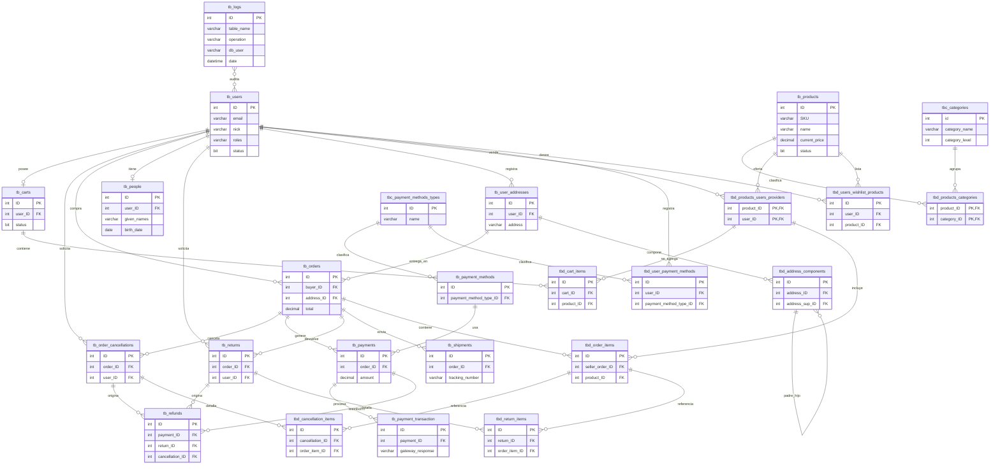

# MERE - Modelo Entidad-Relacion Extendido

**Proyecto:** Practica 03 - Bases de datos en la nube  
**Base de datos:** `db_test`  
**Modelo:** relacional, 24 tablas operativas + 1 tabla de auditoria

## 1. Objetivo

Describir las entidades, atributos y relaciones del sistema de comercio electronico implementado en `db_test`, incluyendo la trazabilidad de operaciones mediante la tabla `tb_logs`.

## 2. Entidades principales

| Entidad | Tabla | Descripcion |
|---------|-------|-------------|
| Usuario | `tb_users` | Usuarios de la plataforma (compradores, vendedores y personal). |
| Persona | `tb_people` | Datos personales y demograficos asociados a un usuario. |
| Direccion de usuario | `tb_user_addresses` | Direcciones registradas por cada usuario. |
| Producto | `tb_products` | Catalogo de productos publicados. |
| Categoria | `tbc_categories` | Catalogo jerarquico de categorias y subcategorias. |
| Carrito | `tb_carts` | Carritos de compra de los usuarios. |
| Pedido | `tb_orders` | Pedidos generados a partir de un carrito. |
| Pago | `tb_payments` | Pagos asociados a un pedido. |
| Envio | `tb_shipments` | Envios y seguimiento de pedidos. |
| Devolucion | `tb_returns` | Devoluciones solicitadas por los usuarios. |
| Cancelacion | `tb_order_cancellations` | Solicitudes de cancelacion de pedidos. |
| Reembolso | `tb_refunds` | Reembolsos originados por devoluciones o cancelaciones. |

## 3. Entidades de relacion

| Entidad | Tabla | Descripcion |
|---------|-------|-------------|
| Componente de direccion | `tbd_address_components` | Componentes jerarquicos de una direccion (pais, estado, ciudad, colonia, calle). |
| Producto-Categoria | `tbd_products_categories` | Relacion muchos-a-muchos entre productos y categorias. |
| Producto-Proveedor | `tbd_products_users_providers` | Relacion producto-proveedor; identifica al vendedor de cada producto. |
| Item de carrito | `tbd_cart_items` | Productos agregados a un carrito. |
| Item de pedido | `tbd_order_items` | Detalle de productos y cantidades de un pedido. |
| Item de cancelacion | `tbd_cancellation_items` | Detalle de los items cancelados. |
| Item de devolucion | `tbd_return_items` | Detalle de productos devueltos. |
| Metodo de pago del usuario | `tbd_user_payment_methods` | Metodos de pago registrados por cada usuario. |
| Lista de deseos | `tbd_users_wishlist_products` | Lista de deseos de los usuarios. |
| Metodo de pago | `tb_payment_methods` | Metodos de pago disponibles por tipo. |
| Tipo de metodo de pago | `tbc_payment_methods_types` | Tipos de metodo de pago (tarjeta, transferencia, etc.). |
| Transaccion de pago | `tb_payment_transaction` | Transacciones y respuestas de la pasarela de pago. |
| Bitacora | `tb_logs` | Bitacora de auditoria generada por los 72 triggers. |

## 4. Diagrama MERE

> Nota: `tb_logs` no tiene llave foranea fisica; se relaciona logicamente con todas las tablas mediante `table_name` + `record_id`.

## 5. Cardinalidades

| Entidad padre | Entidad hija | Cardinalidad | Regla de negocio |
|---------------|--------------|--------------|------------------|
| `tb_users` | `tb_carts` | 1:1 | Un registro de `tb_users` posee muchos de `tb_carts`. |
| `tb_orders` | `tb_order_cancellations` | 1:N | Un registro de `tb_orders` cancela muchos de `tb_order_cancellations`. |
| `tb_users` | `tb_order_cancellations` | 1:N | Un registro de `tb_users` solicita muchos de `tb_order_cancellations`. |
| `tb_user_addresses` | `tb_orders` | 1:N | Un registro de `tb_user_addresses` entrega en muchos de `tb_orders`. |
| `tb_users` | `tb_orders` | 1:N | Un registro de `tb_users` compra muchos de `tb_orders`. |
| `tbc_payment_methods_types` | `tb_payment_methods` | 1:N | Un registro de `tbc_payment_methods_types` clasifica muchos de `tb_payment_methods`. |
| `tb_payments` | `tb_payment_transaction` | 1:N | Un registro de `tb_payments` procesa muchos de `tb_payment_transaction`. |
| `tb_orders` | `tb_payments` | 1:N | Un registro de `tb_orders` genera muchos de `tb_payments`. |
| `tb_payment_methods` | `tb_payments` | 1:N | Un registro de `tb_payment_methods` usa muchos de `tb_payments`. |
| `tb_users` | `tb_people` | 1:1 | Un registro de `tb_users` tiene muchos de `tb_people`. |
| `tb_order_cancellations` | `tb_refunds` | 1:N | Un registro de `tb_order_cancellations` origina muchos de `tb_refunds`. |
| `tb_payments` | `tb_refunds` | 1:N | Un registro de `tb_payments` reembolsa muchos de `tb_refunds`. |
| `tb_returns` | `tb_refunds` | 1:N | Un registro de `tb_returns` origina muchos de `tb_refunds`. |
| `tb_orders` | `tb_returns` | 1:N | Un registro de `tb_orders` devuelve muchos de `tb_returns`. |
| `tb_users` | `tb_returns` | 1:N | Un registro de `tb_users` solicita muchos de `tb_returns`. |
| `tb_orders` | `tb_shipments` | 1:N | Un registro de `tb_orders` envia muchos de `tb_shipments`. |
| `tb_users` | `tb_user_addresses` | 1:N | Un registro de `tb_users` registra muchos de `tb_user_addresses`. |
| `tb_user_addresses` | `tbd_address_components` | 1:N | Un registro de `tb_user_addresses` compone muchos de `tbd_address_components`. |
| `tbd_address_components` | `tbd_address_components` | 1:N (jerarquia) | Un registro de `tbd_address_components` padre hijo muchos de `tbd_address_components`. |
| `tb_order_cancellations` | `tbd_cancellation_items` | 1:N | Un registro de `tb_order_cancellations` detalla muchos de `tbd_cancellation_items`. |
| `tbd_order_items` | `tbd_cancellation_items` | 1:N | Un registro de `tbd_order_items` referencia muchos de `tbd_cancellation_items`. |
| `tb_carts` | `tbd_cart_items` | 1:N | Un registro de `tb_carts` contiene muchos de `tbd_cart_items`. |
| `tbd_products_users_providers` | `tbd_cart_items` | 1:N | Un registro de `tbd_products_users_providers` se agrega muchos de `tbd_cart_items`. |
| `tbd_products_users_providers` | `tbd_order_items` | 1:N | Un registro de `tbd_products_users_providers` incluye muchos de `tbd_order_items`. |
| `tb_orders` | `tbd_order_items` | 1:N | Un registro de `tb_orders` contiene muchos de `tbd_order_items`. |
| `tbc_categories` | `tbd_products_categories` | 1:N | Un registro de `tbc_categories` agrupa muchos de `tbd_products_categories`. |
| `tb_products` | `tbd_products_categories` | 1:N | Un registro de `tb_products` clasifica muchos de `tbd_products_categories`. |
| `tb_products` | `tbd_products_users_providers` | 1:N | Un registro de `tb_products` oferta muchos de `tbd_products_users_providers`. |
| `tb_users` | `tbd_products_users_providers` | 1:N | Un registro de `tb_users` vende muchos de `tbd_products_users_providers`. |
| `tbd_order_items` | `tbd_return_items` | 1:N | Un registro de `tbd_order_items` referencia muchos de `tbd_return_items`. |
| `tb_returns` | `tbd_return_items` | 1:N | Un registro de `tb_returns` detalla muchos de `tbd_return_items`. |
| `tbc_payment_methods_types` | `tbd_user_payment_methods` | 1:N | Un registro de `tbc_payment_methods_types` clasifica muchos de `tbd_user_payment_methods`. |
| `tb_users` | `tbd_user_payment_methods` | 1:N | Un registro de `tb_users` registra muchos de `tbd_user_payment_methods`. |
| `tb_products` | `tbd_users_wishlist_products` | 1:N | Un registro de `tb_products` lista muchos de `tbd_users_wishlist_products`. |
| `tb_users` | `tbd_users_wishlist_products` | 1:N | Un registro de `tb_users` desea muchos de `tbd_users_wishlist_products`. |

## 6. Reglas de negocio

1. Un usuario puede tener cero o un registro en `tb_people` (1:1).
2. Un usuario puede registrar varias direcciones, carritos, pedidos y metodos de pago.
3. Un producto pertenece al menos a una categoria mediante `tbd_products_categories`.
4. Un producto es ofertado por un vendedor en `tbd_products_users_providers`.
5. Un pedido se compone de uno o varios `tbd_order_items` y puede generar uno o varios pagos.
6. Un pago puede tener varias transacciones; al eliminar el pago se eliminan sus transacciones (CASCADE).
7. Una devolucion o cancelacion puede originar un reembolso.
8. Las categorias y direcciones son jerarquicas (auto-referencia).
9. La baja de productos es logica (`status = 0`), no fisica.
10. Toda operacion INSERT/UPDATE/DELETE sobre las 24 tablas operativas se registra en `tb_logs` mediante 72 triggers.
